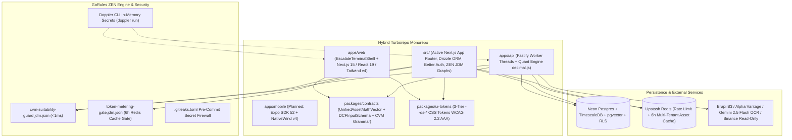

# 02 — Technical Requirements & Architecture Document (TRD)
**Project**: Escalate — Project Midas (`simulador-financeiro`)
**Governance Framework**: `AGENTS.md` (`v3.0.0-ULTRA-MESH`)
**Document Status**: `APPROVED_AND_LOCKED` (`5/5` Signatures)
**Target Horizon**: Canonical Hybrid Monorepo (`v1.2.0` / `v2.0.0`)
**Lead Persona**: `@agent-software-engineer` (Co-Reviewed by `@agent-orchestrator`, `@agent-design`, `@agent-cybersecurity`)

---

## 1. Hybrid Turborepo Architecture & Runtime Topology

Escalate utilizes a **Non-Destructive Hybrid Monorepo** managed by Turborepo (`turbo.json`, `pnpm-workspace.yaml`, `package.json` workspaces) allowing decoupled workspace packages (`apps/*`, `packages/*`) to coexist seamlessly with the active Next.js 15 root application (`src/app/*`, `src/core/*`, `tests/*`):

---

## 2. Canonical Technology Stack & Version Matrix

| Layer | Package / Primitive | Target / Locked Version | Architectural Role |
| :--- | :--- | :--- | :--- |
| **Monorepo Orchestrator** | `turbo` + `typescript` | `^2.3.3` / `^5` | Task graph caching (`build`, `typecheck`, `test`, `dev:local`, `dev:doppler`). |
| **Web Frontend** | `next` + `react` + `tailwindcss` | `^15.5.2` / `^19.2.0` / `^4` | App Router UI, `EscalateTerminalShell`, `--ds-*` WCAG 2.2 AAA design tokens. |
| **Mobile (Target Architecture)** | Expo SDK + NativeWind | `SDK 52` / `v4` | Planned cross-platform terminal sharing `@escalate/contracts` & `@escalate/ui-tokens`. |
| **Quant Backend & Runtime** | Node.js LTS + Fastify (Target) + `decimal.js` | `^10.5.0` (Decimal.js) | Deterministic 128-bit arithmetic (`precision: 36`, `ROUND_HALF_EVEN`) in Worker Threads. |
| **Contracts & Validation** | `zod` (`@escalate/contracts`) | `^3.24.2` | `UnifiedAssetMathVectorSchema`, `DCFInputSchema` (`WACC > g`), CVM grammar regex. |
| **Deterministic Guardrails** | `@gorules/zen-engine` | `^0.1.0` | JDM rules engine executing `cvm-suitability-guard`, `token-metering-gate`, and goal/health graphs. |
| **Database & Cache** | `@neondatabase/serverless` + `drizzle-orm` + `@upstash/redis` | `^1.1.0` / `^0.45.2` / `^1.38.4` | PostgreSQL + RLS policies, TimescaleDB hypertables, pgvector RAG, 6h asset cache. |
| **Secrets & AppSec** | Doppler CLI + `.gitleaks.toml` | `ADR-001` / `ADR-002` | Zero `.env` secret policy via `doppler run`; regex blocks Binance/Gemini/Anthropic leaks. |
| **Verification** | `vitest` | `^4.1.10` | Unified test runner covering `src/**/*.test.ts`, `tests/**/*.test.ts`, and `apps/**/*.test.ts`. |

---

## 3. Core Architectural Invariants & Technical Specifications

### 3.1 Deterministic Quant Arithmetic (`apps/api/src/modules/quant/quant-engine.ts`)
* **Strict LLM Math Prohibition**: Large Language Models MUST NEVER compute sums, percentages, Sharpe ratios, covariance matrices, or discounted cash flows.
* **128-bit Decimal Precision**: Configured via `Decimal.set({ precision: 36, rounding: Decimal.ROUND_HALF_EVEN })`.
* **DCF Guard (`calculateDiscountedCashFlow`)**: Enforces `wacc > terminalGrowthRate`; throws `GORULES_MATH_GUARD: WACC must be strictly greater than g` if violated.
* **Portfolio Sharpe (`calculatePortfolioSharpe`)**: Aggregates `UnifiedAssetMathVector[]` using exact string decimal quantities and unit prices, returning `totalValue` (`toFixed(2)`), `weightedReturn`, and `sharpeRatio`.
* **Markowitz Covariance & Black-Litterman (`calculateMarkowitzCovariancePortfolio`, `applyBlackLittermanViews`)**: Computes exact multi-asset covariance matrices and blends bounded qualitative views (`[-0.15, 0.15]` cap) off the main event loop via `runQuantTaskIsolated` (`apps/api/src/modules/quant/quant-worker-pool.ts`).
* **6-Hour Multi-Tenant Semantic Asset Cache (`SemanticAssetCache`)**: Coalesces concurrent and repeated qualitative ticker evaluations across a deterministic `21,600,000 ms` (`6h`) window (`apps/api/src/modules/agent/semantic-asset-cache.ts`), eliminating redundant LLM token expenditure across subscribers.

### 3.2 GoRules ZEN Engine Guardrails (`src/core/decision/graphs/`)
1. **`cvm-suitability-guard.jdm.json`**:
   - Intercepts imperative investment advice verbs (`Compre`, `Venda`, `Aloque`, `Invista`, `Resgate`, `Troque`) per **CVM Resolution 20**.
   - Validates `waccGtGrowth` and risk profile volatility ceilings (`CONSERVADOR <= 800 bps`, `MODERADO <= 1800 bps`).
   - Complemented synchronously in `@escalate/contracts` by `enforceCvmResolution20Grammar(text)` which returns `[CVM_RESOLUTION_20_BLOCK]` on violation or appends `[DISCLAIMER CVM]` on analytical pass.
2. **`token-metering-gate.jdm.json`**:
   - Routes deterministic parsers (`SINACOR PDF`, `B3 CSV`) and `decimal.js` math directly to `DETERMINISTIC_WORKER` (`0` tokens).
   - Serves repeated multi-tenant ticker evaluations from `REDIS_CACHE_6H` (`21600s` TTL).
   - Enforces monthly tenant token quota caps (`250,000` tokens) before invoking `LLM_QUALITATIVE_COPILOT`.

### 3.3 Legacy Pure Core & Security Controls (`src/core/`, `src/middleware.ts`)
* Preserves `src/core/jurosCompostos.ts`, `src/core/comparadorInvestimentos.ts`, `src/core/validadorSimulacao.ts`, and `src/core/quant/` (`density-matrix.ts`, `quantum-walk.ts`) without breaking any existing route.
* Preserves dual-layer Upstash rate limiting (`auth: 5/60s`, `api: 10/10s`, Brapi `15/60s`, Alpha Vantage `5/60s`) and Drizzle `pgPolicy` RLS isolation on `simulacoes`.

### 3.4 Zero-`.env` Secret Management & Gitleaks Firewall
* `package.json` exposes `"dev:doppler": "doppler run -- turbo run dev"` alongside local fallbacks `"dev": "next dev"` and `"dev:local": "turbo run dev"`.
* `.gitleaks.toml` enforces `binance-api-key` (64-char key/secret detection) and `llm-provider-keys` (`AIza...`, `sk-ant-api03-...`) scanning via `npm run security:scan`.

---

## 4. Governance Sign-Off (`02_TRD.md` — 5/5 Slot)

| Persona | Role | Status | Note |
| :--- | :--- | :---: | :--- |
| **`@human-developer`** | Product Owner & Architect | `APPROVED` | Approved Option A Hybrid Monorepo & fallback dev scripts. |
| **`@agent-orchestrator`** | Swarm PM & Triage Lead | `APPROVED` | All workspace path aliases (`@escalate/contracts`, `@escalate/ui-tokens`) verified. |
| **`@agent-design`** | UI/UX & Design System Lead | `APPROVED` | `packages/ui-tokens/src/tokens.css` integrated into `src/app/globals.css`. |
| **`@agent-software-engineer`** | Principal Full-Stack Architect | `APPROVED` | `decimal.js` Worker Thread architecture and TypeScript strictness locked. |
| **`@agent-cybersecurity`** | Shift-Left AppSec Gatekeeper | `APPROVED` | `.gitleaks.toml`, Doppler CLI, and GoRules JDM guardrails verified. |
