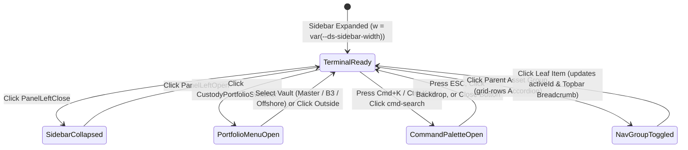
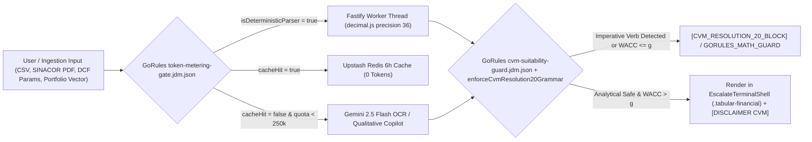

# 03 — Application Flow, Navigation & State Machines (`03_APP_FLOW.md`)
**Project**: Escalate — Project Midas (`simulador-financeiro`)
**Governance Framework**: `AGENTS.md` (`v3.0.0-ULTRA-MESH`)
**Document Status**: `APPROVED_AND_LOCKED` (`5/5` Signatures)
**Target Horizon**: Canonical Baseline + Escalate Terminal Shell (`v1.2.0` / `v2.0.0`)
**Lead Persona**: `@agent-design` (Co-Reviewed by `@agent-orchestrator`, `@agent-software-engineer`, `@agent-cybersecurity`)

---

## 1. Route & Shell Topology

Escalate maintains full compatibility across existing Next.js 15 routes while introducing the composable **`EscalateTerminalShell`** (`apps/web/src/components/shell/EscalateTerminalShell.tsx`, re-exported via `src/components/shell/EscalateTerminalShell.tsx` and `src/components/shell/PlatformShell.tsx`):

| Route / Shell Surface | Component / File | Access Level | Behavioral Contract |
| :--- | :--- | :--- | :--- |
| **Terminal Shell** | `EscalateTerminalShell.tsx` | Public / Auth | Collapsible 11-class custody sidebar, `CustodyPortfolioSwitcher`, Telemetry Topbar, `Cmd+K` Command Palette. |
| `/` | `src/app/page.tsx` | Public | Entry & simulation overview. |
| `/investimentos`, `/produtos`, `/agent` | `src/app/**/page.tsx` | Public / Hybrid | Preserved PlatformShell routes (Calendar, 8-class Product Critical Analysis, DTQW Quant + ZEN). |
| `/app`, `/app/comparador` | `src/app/app/**/page.tsx` | Hybrid (Guest + Auth) | URL Search Param hydration + `BlocoSalvarSimulacao` when authenticated. |
| `/app/minhas-simulacoes` | `src/app/app/minhas-simulacoes/page.tsx` | Auth Protected (`307` -> `/login`) | Parameter-only saved scenario recalculation + inline delete state machine. |

---

## 2. EscalateTerminalShell Navigation & Command Palette State Machine

---

## 3. Quantitative Computation & Zero-LLM Gate Flow

---

## 4. Legacy Simulator & Scenario Card State Machines (Preserved)

1. **URL Search Parameter Hydration (`SimuladorJurosCompostos` & `ComparadorInvestimentos`)**:
   - Deterministic query hydration (`/app?valorInicial=...&aporteMensal=...&taxaAnual=...&periodo=...&unidade=...` and `/app/comparador?valorInicial=...&selic=...&cdi=...`) validated via `validadorSimulacao.ts`.
   - Collapsible `"Parametros Avancados"` accordion in `ComparadorInvestimentos.tsx` (`taxaCustodiaTesouroAnual`, `taxaReferencialMensal`).
2. **Inline Card Delete State Machine (`/app/minhas-simulacoes`)**:
   - `IDLE -> CONFIRMING_DELETE -> DELETING -> REMOVED | ERROR`, calling `DELETE /api/simulacoes/[id]` with ownership check and uniform `404` anti-enumeration.

---

## 5. Governance Sign-Off (`03_APP_FLOW.md` — 5/5 Slot)

| Persona | Role | Status | Note |
| :--- | :--- | :---: | :--- |
| **`@human-developer`** | Product Owner & Architect | `APPROVED` | Confirmed non-destructive shell coexistence with existing routes. |
| **`@agent-orchestrator`** | Swarm PM & Triage Lead | `APPROVED` | Navigation and Quant/GoRules state machines aligned with `01_PRD.md`. |
| **`@agent-design`** | UI/UX & Design System Lead | `APPROVED` | Smooth `grid-rows` custody accordion and `Cmd+K` modal accessibility specified. |
| **`@agent-software-engineer`** | Principal Full-Stack Architect | `APPROVED` | Deterministic worker routing prevents LLM arithmetic drift. |
| **`@agent-cybersecurity`** | Shift-Left AppSec Gatekeeper | `APPROVED` | GoRules CVM Resolution 20 and token quota gates enforced prior to rendering. |
